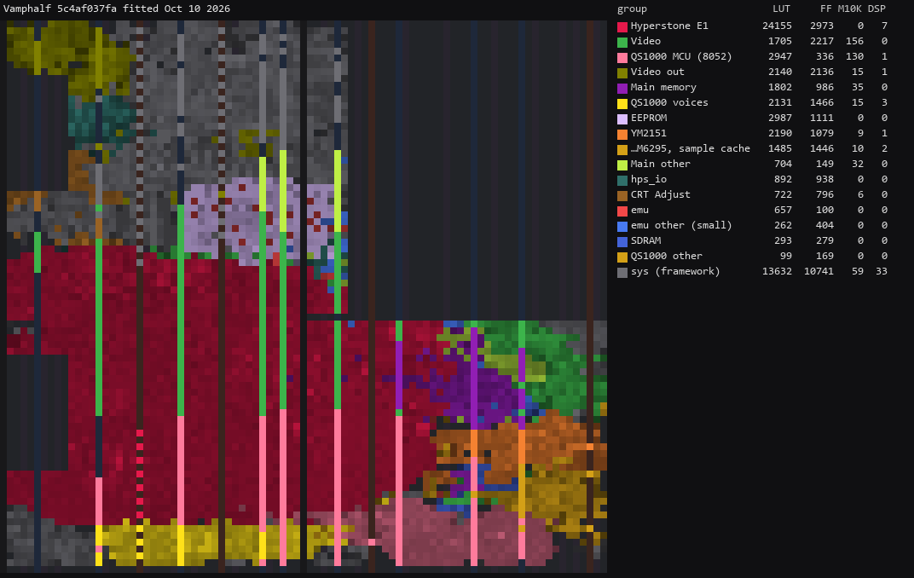
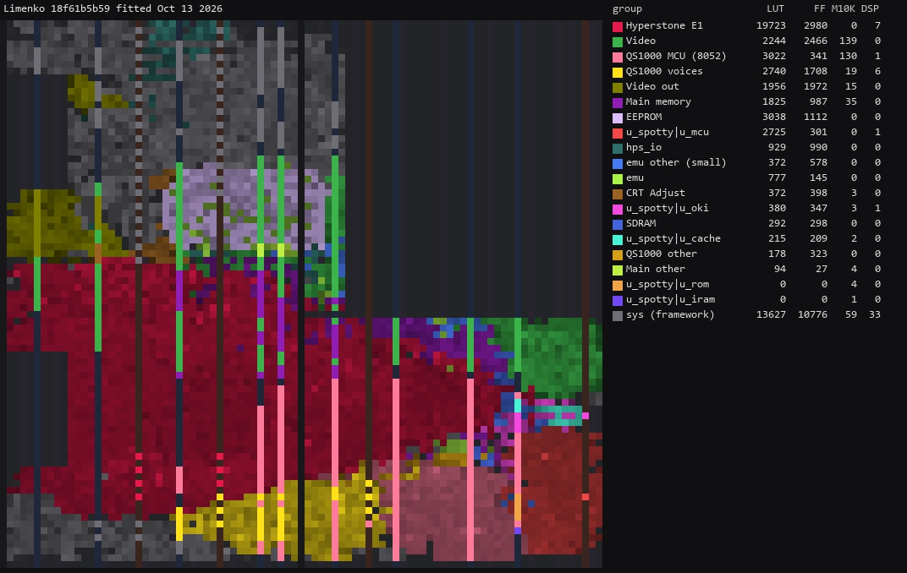

# Vamphalf core for MiSTer

A MiSTer FPGA core for the Hyperstone E1-based arcade boards of MAME's `vamphalf` driver (Danbi /
F2 System, SemiCom, Sun, Omega System, Logic), built with Quartus Prime 17.0.2 Lite for the DE10-nano.
The same repository builds a second core, `Limenko`, for MAME's `limenko.cpp` (Limenko Power System 2):
see [Limenko core](#limenko-core).

**Status: work in progress. Some games lose a small number of frames that do not complete in time.
Boong-Ga Boong-Ga and Age Of Heroes need the 128 MB SDRAM module.**

## Contents

- [History](#history)
- [Status](#status)
- [Games](#games)
  - [Supported](#supported)
  - [Supported (Limenko core)](#supported-limenko-core)
- [Hardware](#hardware)
  - [Video timing](#video-timing)
  - [Floorplan](#floorplan)
- [Installation](#installation)
- [Controls](#controls)
- [Status](#status-1)
  - [Todo](#todo)
  - [Resource usage](#resource-usage)
- [Limenko core](#limenko-core)
- [AI Attestation](#ai-attestation)
- [Verification](#verification)
- [Acknowledgements](#acknowledgements)
- [Layout](#layout)
- [License](#license)

## History

* **20261013** (`releases/Arcade-Limenko_20261013.rbf`)
  * New core, Limenko Power System 2: Dynamite Bomber, Legend of Heroes, Super Bubble 2003 (two sets),
    To Heart House, Spotty ([Limenko core](#limenko-core))
  * QS1000, in this core and in the source for the next Vamphalf release: IMA ADPCM, looping with a key-off
    fade, pitch bend, and the left and right volumes swapped against MAME's (Verification)

* **20261010** (`releases/Arcade-Vamphalf_20261010.rbf`)
  * New set: Age Of Heroes - Silkroad 2 (128 MB SDRAM)
  * Pipelined E1 CPU: About 35% faster per-clock
  * Boong-Ga Boong-Ga: the Test menu's items can be used (Start to move, Right to select) (unlike MAME)

* **20261009** (`releases/Arcade-Vamphalf_20261009.rbf`)
  * New sets: Mr. Kicker (SEMICOM-003b PCB), Boong-Ga Boong-Ga (128 MB SDRAM), Solitaire, Final Godori,
    Yori Jori Kuk Kuk
  * CPU: SETADR fix, which stops Mr. Kicker (SEMICOM-003b PCB) hanging when it rewrites its EEPROM and Yori Jori Kuk Kuk from booting without a CPU fix (PR for MAME too)

* **20261008** (`releases/Arcade-Vamphalf_20261008.rbf`)
  * Initial release
  * QS1000 sound: the level of the effects against the music set from a PCB recording, not MAME's
  * A few games suffer a little slowdown/dropped frames, will continue to work on it
  * Fast ROM loading
  * CRT Adjust
  * Flip screen, HDMI rotation
  * MAME's default keyboard mapping

## Status

**Status**: All listed games run and are playable with sound.

Age of Heroes needs an _80MHz_ CPU core. It does all of its screen drawing in the vblank period in a few scanlines.
As the CPU isn't fast enough yet, it results in some screen tearing when scrolling vertically (luckily it's a side-scroller...).
To avoid this, I'm delaying the screen drawing until much later (read hack), resulting in one screen of lag.

## Games

The supported sets run on five boards: the E1-16 (GMS30C2116 / E1-16T) board with a QS1000 sound board
(Mission Craft), the E1-32 board with a QS1000 (Wivern Wings, Yori Jori Kuk Kuk), the E1-16 board with a YM2151 and an
OKI M6295 (24 sets, in nine I/O map families), and the E1-32 board with the YM2151 and a banked M6295
(Mr. Kicker, SEMICOM-003b PCB; Final Godori, with a 32 KB backup RAM), and Unico's E1-32XN board at 80 MHz with a
YM2151 and two M6295s (Age Of Heroes: a 384 x 224 screen and 18-bit sprite codes). All five have the same video: one layer of
16x16 sprites from a list in sprite RAM, and a 15-bit palette.

### Supported

| Name | Year | Manufacturer | Set | Board | MAME trace | Notes |
|-|-|-|-|-|-|-|
| Mission Craft (version 2.7) | 2000 | Sun | `misncrft` | E1-16, QS1000 | 1,000,000 of 1,000,000 | |
| Mission Craft (version 2.4) | 2000 | Sun | `misncrfta` | E1-16, QS1000 | | Clone of `misncrft` |
| Wivern Wings | 2001 | SemiCom | `wivernwg` | E1-32, QS1000 | 8,000,000 (CPU bench) | |
| Wyvern Wings (set 1) | 2001 | SemiCom (Game Vision license) | `wyvernwg` | E1-32, QS1000 | | Clone of `wivernwg` |
| Wyvern Wings (set 2) | 2001 | SemiCom (Game Vision license) | `wyvernwga` | E1-32, QS1000 | | Clone of `wivernwg` |
| Yori Jori Kuk Kuk | 2002 | Golden Bell Entertainment | `yorijori` | E1-32, QS1000 | 439,730, then the timer interrupt's timing differs | MACHINE_NOT_WORKING in MAME, which patches the program to boot; with the SETADR fix it boots unpatched (Verification) |
| Vamf x1/2 (Europe, version 1.1.0908) | 1999 | Danbi / F2 System | `vamphalf` | E1-16, YM2151 + M6295 | 893,119, then the YM2151's busy flag is polled a different number of times | |
| Vamf x1/2 (Europe, version 1.0.0903) | 1999 | Danbi / F2 System | `vamphalfr1` | E1-16, YM2151 + M6295 | | Clone of `vamphalf` |
| Vamp x1/2 (Korea, version 1.1.0908) | 1999 | Danbi / F2 System | `vamphalfk` | E1-16, YM2151 + M6295 | | Clone of `vamphalf` |
| Cool Minigame Collection | 1999 | SemiCom | `coolmini` | E1-16, YM2151 + M6295 | 1,000,000 of 1,000,000 | |
| Cool Minigame Collection (Italy) | 1999 | SemiCom | `coolminii` | E1-16, YM2151 + M6295 | | Clone of `coolmini` |
| Date Quiz Go Go Episode 2 | 2000 | SemiCom | `dquizgo2` | E1-16, YM2151 + M6295 | | coolmini's board |
| Toy Land Adventure | 2001 | SemiCom | `toyland` | E1-16, YM2151 + M6295 | | coolmini's board |
| Mr. Kicker (F-E1-16-010 PCB) | 2001 | SemiCom | `mrkicker` | E1-16, YM2151 + M6295 | 1,000,000 of 1,000,000 | |
| Mr. Kicker (SEMICOM-003b PCB) | 2001 | SemiCom | `mrkickera` | E1-32, YM2151 + M6295 | 1,000,000 of 1,000,000 | Clone of `mrkicker`. MACHINE_NOT_WORKING in MAME, which hangs when the game rewrites its EEPROM; the core fixes the CPU fault behind it (Verification) |
| Diet Family | 2001 | SemiCom | `dtfamily` | E1-16, YM2151 + M6295 | | mrkicker's board |
| Jumping Break (set 1) | 1999 | F2 System | `jmpbreak` | E1-16, YM2151 + M6295 | 1,000,000 of 1,000,000 | |
| Jumping Break (set 2) | 1999 | F2 System | `jmpbreaka` | E1-16, YM2151 + M6295 | | Clone of `jmpbreak` |
| Poosho Poosho | 1999 | F2 System | `poosho` | E1-16, YM2151 + M6295 | | jmpbreak's board |
| New Cross Pang (set 1) | 1999 | F2 System | `newxpang` | E1-16, YM2151 + M6295 | | mrdig's board |
| New Cross Pang (set 2) | 1999 | F2 System | `newxpanga` | E1-16, YM2151 + M6295 | | Clone of `newxpang` (jmpbreak's board) |
| Mr. Dig | 2000 | Sun | `mrdig` | E1-16, YM2151 + M6295 | 1,000,000 of 1,000,000 | |
| Super Lup Lup Puzzle / Zhuan Zhuan Puzzle (version 4.0 / 990518) | 1999 | Omega System | `suplup` | E1-16, YM2151 + M6295 | 1,000,000 of 1,000,000 | |
| Lup Lup Puzzle / Zhuan Zhuan Puzzle (version 3.0 / 990128) | 1999 | Omega System | `luplup` | E1-16, YM2151 + M6295 | | Clone of `suplup` |
| Lup Lup Puzzle / Zhuan Zhuan Puzzle (version 2.9 / 990108) | 1999 | Omega System | `luplup29` | E1-16, YM2151 + M6295 | | Clone of `suplup` |
| Lup Lup Puzzle / Zhuan Zhuan Puzzle (version 1.05 / 981214) | 1999 | Omega System (Adko license) | `luplup10` | E1-16, YM2151 + M6295 | | Clone of `suplup` |
| Puzzle Bang Bang (Korea, version 2.9 / 990108) | 1999 | Omega System | `puzlbang` | E1-16, YM2151 + M6295 | | Clone of `suplup` |
| Puzzle Bang Bang (Korea, version 2.8 / 990106) | 1999 | Omega System | `puzlbanga` | E1-16, YM2151 + M6295 | | Clone of `suplup` |
| World Adventure | 1999 | Logic / F2 System | `worldadv` | E1-16, YM2151 + M6295 | 1,000,000 of 1,000,000 | Protection: MAME's seven checks replayed, 0 differ |
| Solitaire (version 2.5) | 1999 | F2 System | `solitaire` | E1-16, YM2151 + M6295 | 869,671, then a YM2151 status read differs (busy in MAME) | Eleven buttons (Controls) |
| Final Godori (Korea, version 2.20.5915) | 2001 | SemiCom | `finalgdr` | E1-32, YM2151 + banked M6295 | 1,000,000 of 1,000,000 | 32 KB backup RAM, saved in the `.nvm` after the EEPROM |
| Age Of Heroes - Silkroad 2 (v0.63 - 2001/02/07) | 2001 | Unico | `aoh` | E1-32XN, YM2151 + two M6295 | 1,000,000 of 1,000,000 | Needs the 128 MB SDRAM module (64 MB of graphics) |
| Boong-Ga Boong-Ga (Spank'em!) | 2001 | Taff System | `boonggab` | E1-16, YM2151 + banked M6295 | 1,000,000 of 1,000,000 | Needs the 128 MB SDRAM module (28 MB of graphics). Four buttons give four of the photo sensors' seven hit strengths (`docs/HACKS.md`) |

### Supported (Limenko core)

The `Limenko` core's sets ([Limenko core](#limenko-core)), on Limenko's Power System 2 (an E1-32XN cartridge
system) except Spotty, whose board has a GMS30C2232 (an E1-32 second source), the same video chip and its own
sound board.

| Name | Year | Manufacturer | Set | Board | MAME trace | Notes |
|-|-|-|-|-|-|-|
| Dynamite Bomber (Korea, Rev 1.5) | 2000 | Limenko | `dynabomb` | Power System 2, QS1000 | 957,951, to the first vertical-blank interrupt | |
| Legend of Heroes | 2000 | Limenko | `legendoh` | Power System 2, QS1000 | 284,101, to the first vertical-blank interrupt | Four players' inputs, on pads 3 and 4 (not tried with four); the link between two cabinets is not emulated, in MAME either |
| Super Bubble 2003 (World, Ver 1.0) | 2003 | Limenko | `sb2003` | Power System 2, QS1000 | 1,000,000 of 1,000,000 | |
| Super Bubble 2003 (Asia, Ver 1.0) | 2003 | Limenko | `sb2003a` | Power System 2, QS1000 | | Clone of `sb2003` |
| To Heart House | 200? | Limenko | `hrthouse` | Power System 2, QS1000 | 268,357, to the first vertical-blank interrupt | MAME marks its graphics imperfect (sprite and tilemap priorities, sprite scrolling); the core draws what MAME draws. 4 KB NVRAM, saved in the `.nvm` after the EEPROM |
| Spotty (Ver. 2.0.2) | 2001 | Prince Co. | `spotty` | GMS30C2232, AT89C4051 + M6295 | 474,527, then a timer interrupt's timing differs | |

## Hardware

| Chip | Function | Status |
|-|-|-|
| Hyperstone E1-16T / GMS30C2116, E1-32T, 50 MHz; E1-32XN, 80 MHz (Age Of Heroes) | Main CPU | Written here from MAME's `e132xs`: `rtl/e1/e1_pipe.sv`, pipelined (fetch and operand read run ahead of execute; the next instruction goes in beside the last clock of an ALU instruction, a load or store, or a predicted branch), built from the multi-cycle `rtl/e1/e1_cpu.sv`, which stays as the reference; behind a 16 KB I-cache and a 4 KB D-cache (`rtl/vh_cpumem.sv`) |
| Sprites and palette | Video | Written here (`rtl/video/vh_video.sv`): rendered per scanline from a copy of the sprite list taken once a frame |
| QS1000 (8052 + 32-voice wavetable) | Sound, QS1000 boards | 8052: jotego's JT8051, changed (`rtl/qs1000/PROVENANCE.md`); wavetable written here from MAME's `qs1000.cpp` (`rtl/qs1000/vh_qs1000_voice.sv`), with the mix balance, IMA ADPCM, looping, a key-off fade, pitch bend and the left and right volumes taken from recordings instead (Verification) |
| YM2151 | FM sound | jotego's JT51 (`rtl/sound/PROVENANCE.md`) |
| OKI M6295 | ADPCM sound | jotego's JT6295, with the Fuuki core's ROM bridge and sample cache |
| 93C46 | Settings EEPROM | From Arcade-KonamiGX_MiSTer |
| Protection | Mission Craft, Wivern Wings, World Adventure | MAME's tables (`vamphalf_prot.cpp`): `rtl/vh_prot.sv`, `rtl/vh_prot_wa.sv` |

### Video timing

28 MHz / 4 = 7 MHz dot clock, 448 dots by 264 lines: 15.625 kHz lines, 59.19 Hz frames. Visible 320 x 236
(dots 31 to 350, lines 16 to 251). Source: MAME's `set_raw` (`vamphalf.cpp:156-161`, `:1150`). The SUPLUP
board's dot clock is 14.318181 MHz / 2 = 7.159 MHz (60.53 Hz, `:1251`); the core runs it at 7 MHz
(`docs/HACKS.md`).

### Floorplan

Where the logic sits on the Cyclone V, read from the compiled design with `scripts/floorplan.py` (blocks defined in `scripts/floorplan.json`). One cell per LAB, M10K or DSP site, coloured by the block owning most of it, brighter when fuller. The thin columns are M10K and DSP; the empty area at the top right is the HPS; grey is the MiSTer framework. LUT counts are combinational cells, two per ALM.

Revision `Vamphalf` at `5c4af03` (the 20261010 release), fitted 10 Oct 2026:

Limenko boards, revision `Limenko`, fitted 13 Oct 2026:

## Installation

A 32 MB SDRAM module is required (the images are up to 24 MB; work RAM sits above them). Boong-Ga
Boong-Ga and Age Of Heroes need the 128 MB module: their graphics are stored above the 32 MB line.

* Take the latest `Arcade-Vamphalf_*.rbf` from `releases/` and put it in `_Arcade/cores`, renamed to drop the
  `Arcade-` prefix (`Arcade-Vamphalf_YYYYMMDD.rbf` becomes `Vamphalf_YYYYMMDD.rbf`)
* Put the `*.mra` files and the `_alternatives` folder from `releases/` in `_Arcade` (or a subdirectory
  starting with an underscore, e.g. `_Arcade/_Vamphalf`)
* Put the MAME merged or split ROM sets in `games/mame`

To build and deploy a development build: `python scripts/build_staged.py`, then `python scripts/deploy.py`
with a `mister.env` (see `scripts/deploy.py`).

## Controls

Pad: Button 1-4, Start, Coin, Pause, Service Coin, Service Mode (the `.mra` names Wivern Wings' Shot,
Defense and Bomb, and Boong-Ga Boong-Ga's four hit strengths). Pause suspends the main CPU. MAME gives the boards no DIP switches; Service Mode is the
test switch, momentary as in MAME (held, not toggled), and has no default pad button.

Keyboard, MAME's defaults: arrows / R F D G, buttons LCtrl LAlt Space LShift / A S Q W, Start 1 / 2,
Coin 5 / 6; F2 service switch, 9 service coin, P pause.

Solitaire has eleven buttons, with MAME's names: Column 1-7, Turn Up Card, Select Turned Up Card, Register
and Gift. In the pad's mapping list, Column 5 onwards come after Service Mode. Keys as MAME: Z X C V B N M for
the columns, A S D F for the other four.

## Status

Known issues:

* **The CPU is still slower than the original in the heaviest frames**: on the bench (1300 frames, coin then
  play, commit `5dab2e1`), frames in which the game never reached its idle loop: New Cross Pang 3, Toy Land 4,
  Jumping Break 0 (the unpipelined CPU at `8585cd4`: 39, 8, 3). The other sets have not been measured.
* **Age Of Heroes shows its sprites one frame later than MAME**: the core takes the sprite list at the start
  of the vertical blank, before the game rewrites it, because the CPU, slower than the original, does not
  finish the rewrite in time for a later copy; a later copy tore when the screen scrolled vertically
  (`docs/HACKS.md`).
* The QS1000 has no envelopes beyond a key-off fade, and no filter; MAME has neither. The 20261010 release
  also follows MAME's ADPCM decoding, its left and right volumes, and its voices stopping at their loop end;
  the source since then, as in the Limenko release, does not (Verification).
* The SUPLUP board's games run 2.2% slow (Video timing).
* Not yet checked on the board: flip screen, the `.nvm` save and restore. The 20261010 release was started on
  the board with Boong-Ga Boong-Ga and Age Of Heroes; the other sets ran on the unpipelined CPU in the
  previous release.

`docs/ROADMAP.md` is the plan and its progress.

### Todo

- [ ] CPU speed (`docs/ROADMAP.md`, Phase 7)
- [ ] Age Of Heroes tearing
- [ ] Video frames against MAME for the sets other than Mission Craft and Wivern Wings
- [ ] Flip screen and `.nvm` on the board

### Resource usage

The release revision (`Vamphalf`, commit `5c4af03`, seed 3) on the DE10-nano's Cyclone V 5CSEBA6, speed
grade 7, every clock meeting timing (clk_sys +0.649 ns, hdmi pll +0.099 ns):

| resource | used | available |
| --- | --- | --- |
| Logic (ALMs) | 34,988 | 41,910 |
| Block memory bits | 3,393,113 | 5,662,720 |
| RAM blocks | 467 | 553 |
| DSP blocks | 48 | 112 |
| PLLs | 3 | 6 |

## Limenko core

`Limenko` is a second core built from this repository, for the games of MAME's `limenko.cpp`
(Limenko Power System 2). It shares the CPU, the QS1000 and the EEPROM with the Vamphalf core. The memory
map, the inputs and the video are its own. Spotty uses the same video chip with its own sound board.

The games are in [Supported (Limenko core)](#supported-limenko-core).

### Hardware

| Chip | Function | Status |
|-|-|-|
| Hyperstone E1-32XN (Spotty: GMS30C2232), 80 MHz on the board | Main CPU | The Vamphalf core's `e1_pipe` and caches, at the core's 56 MHz clock; the CPU's timer counts at 80 MHz |
| L2D_HYP | Video: three 8x8 8bpp tilemaps, bitmap sprites, a 15-bit palette | Written here: `rtl/video/lm_video.sv` draws the tilemaps per scanline; `lm_sprites.sv` draws the sprites into a frame buffer in DDR3, double-buffered and swapped at the vertical-blank interrupt (`lm_fb.sv`), as the board's two frame-buffer DRAMs |
| QS1000 | Sound, all sets but Spotty | As the Vamphalf core; Legend of Heroes' 8052 program banks 2-7 are read from SDRAM |
| AT89C4051 (4 MHz) + OKI M6295 | Spotty's sound | jotego's JT8052 and JT6295 (`rtl/sound/lm_spotty.sv`, `docs/HACKS.md`) |
| 93C46 | Settings EEPROM | As the Vamphalf core |

MAME gives a 384 x 240 screen at 60 Hz and no raw timing. The core uses 8 MHz pixels (32 MHz / 4; the board has
32, 24 and 20 MHz crystals) on a 512 x 264 raster: 59.19 Hz, 384 x 240 visible. Not measured on a board
(`docs/HACKS.md`).

### Installation

A 32 MB SDRAM module is enough: Legend of Heroes, the largest set, takes 30 MB.

* Put `Arcade-Limenko_YYYYMMDD.rbf` from `releases/` in `_Arcade/cores`, renamed `Limenko_YYYYMMDD.rbf`
* The Limenko `.mra` files are in `releases/` with the Vamphalf ones (Super Bubble 2003 (Asia) in
  `_alternatives`); install them the same way

### Controls

Pad: Button 1-4, Start, Coin, Pause, Service Coin, Service Mode, then Button 5-7. The `.mra` names each game's
buttons: Dynamite Bomber's Bomb, Throw and Jump; Super Bubble 2003's Jump and Bubble; Legend of Heroes' Attack
and Jump (buttons 3 and 4 not identified); To Heart House's Hold 1-4, Take / Odd and Bet / Double Up (Start is
Start / Even); Spotty's Hold 1-4, Bet, Stop and Change.

Keyboard: the Vamphalf core's MAME defaults for the joysticks, buttons 1-4, Start, Coin, service and pause.
Buttons 5-7 are on the pad only, and the holds are buttons 1-4, not MAME's poker keys.

The DIP page has Sound Enable (Spotty: Demo Sounds) and, on the QS1000 games, Volume Boost (Status). The OSD
has Flip Screen and, except on Spotty, whose sound is mono, Stereo Mix.

### Status

All six sets play on the board with this release's build, the QS1000 games with sound at the Volume Boost
defaults and Spotty with its own sound board (`debug/hw/lm/legendoh_18f61b5.png`,
`debug/hw/lm/spotty_18f61b5.png`).

Known issues:

* **Volume Boost**: the QS1000 games set the chip's volume register far lower than Mission Craft does, and
  they are near silent in MAME. Volume Boost raises them in 6 dB steps. Each set's default (Dynamite Bomber and
  Super Bubble 2003 +18 dB, Legend of Heroes +12 dB, To Heart House +24 dB) brings its level in play within
  3 dB of Mission Craft's, as rendered from MAME's register writes. No Limenko board has been measured
  (`docs/HACKS.md`); on the MiSTer the defaults sound right.
* The tilemaps and palette are read as the game writes them, not copied at the vertical blank. In Legend of
  Heroes a change can show on the top 13 lines one frame earlier than in MAME (`docs/HACKS.md`).
* Flip screen is checked in simulation only.

### Resource usage

The release revision (`Limenko`, commit `18f61b5`, default seed), every clock meeting timing (clk_sys
+1.250 ns, hdmi pll +0.475 ns; worst hold +0.242 ns):

| resource | used | available |
| --- | --- | --- |
| Logic (ALMs) | 32,656 | 41,910 |
| Block memory bits | 3,045,468 | 5,662,720 |
| RAM blocks | 414 | 553 |
| DSP blocks | 49 | 112 |
| PLLs | 3 | 6 |

### Verification

MAME's `limenko.cpp` is the reference; the core's departures are in `docs/HACKS.md` and `docs/MAME_KLUDGES.md`.

* Whole board (`sim/lm_tb`) against MAME's trace from reset: `sb2003` 1,000,000 of 1,000,000 instructions;
  `dynabomb`, `legendoh` and `hrthouse` up to the first vertical-blank interrupt (957,951, 284,101 and 268,357);
  `spotty` up to 474,527, where MAME takes a timer interrupt the game set for the next timer tick. Over 300
  frames the EEPROM ends identical to MAME's in all five parent sets, and To Heart House's NVRAM too.
* Video: a model of MAME's drawing is pixel-identical to MAME on 210 of 210 captured frames (five sets,
  attract and play); the video RTL (`sim/lm_video_tb`) is identical to the model on all 210, tiles and
  sprites. In the whole board, Dynamite Bomber's frames 1500-1510 are pixel-identical to MAME's 1495-1505;
  Legend of Heroes' match MAME's apart from lines 0-12 (Known issues).
* Flip screen: Dynamite Bomber's frames 700, 1500 and 1501 flipped equal the unflipped frames turned
  180 degrees, every pixel.
* QS1000: the 8052 agrees with MAME's trace for 3,000,000 instructions on `dynabomb` and `sb2003` and
  14,000,000 on `legendoh` (its banked reads included).
* Spotty's sound board (`sim/spotty_tb`) against MAME's AT89C4051 trace: 3,300,000 instructions, attract and
  play, 0 mismatches in state, M6295 writes and status reads.
* Volume Boost (`sim/lm_top_tb`, `sb2003`, 1140 frames): every output sample equals the QS1000's output
  shifted and clamped.
* `.mra`: every set's image is identical to MAME's ROM_START (`scripts/build_mra_lm.py`); the fast load leaves
  SDRAM, the QS1000's program and the EEPROM identical to the image (`sim/lm_top_tb`).

## AI Attestation

This core is being developed with heavy use of a frontier coding assistant.

## Verification

MAME's `vamphalf.cpp`, `vamphalf_prot.cpp`, `qs1000.cpp` and `e132xs` are the reference, except for the
QS1000's mix balance, ADPCM decoding, looping, key-off fade, pitch bend and left and right volumes, which
come from recordings, and the E1's SETADR instruction (all below). Where the core
follows MAME on something MAME marks as uncertain, it is listed in `docs/MAME_KLUDGES.md`; the core's own
approximations are in `docs/HACKS.md`.

* CPU: `rtl/e1/e1_pipe.sv`, and `rtl/e1/e1_cpu.sv` it was built from, agree with MAME's interpreter after
  every instruction (PC, SR, all registers, every bus access), at 0 and 3 bus wait states, on Mission
  Craft's first 1,000,000 instructions, Wivern Wings' first 8,000,000 (E1-32) and the random conformance
  suite (`scripts/e1_regress.py`, 255 of 255 primary opcodes; `--replay --pipe` for `e1_pipe`).
* Whole board (`sim/sys_tb`, the SDRAM controller and a chip model) against MAME's trace from reset:
  1,000,000 of 1,000,000 instructions on `misncrft`, `coolmini`, `mrkicker`, `mrkickera`, `jmpbreak`, `mrdig`,
  `suplup`, `worldadv`, `boonggab` and `finalgdr`; 893,119 on `vamphalf` and 869,671 on `solitaire`, each
  followed by a YM2151 status read that differs. `finalgdr` from a saved backup RAM: its first 2,091
  backup RAM accesses as MAME's.
* Video: the line engine renders 38 of 38 frames per set pixel-identical to a model of MAME's
  `draw_sprites`, which is pixel-identical to MAME on 342 of 342 captured frames of `misncrft` and of
  `wivernwg`.
* `.mra`: every set's image is identical to MAME's ROM_START image (`scripts/build_mra.py`).
* ROM loading (`sim/top_tb`): the byte path and the fast load both leave SDRAM, the QS1000's u7 and the
  EEPROM identical to the image (or to a `.nvm` loaded after it); `finalgdr`'s backup RAM identical to its
  `.nvm`, and the save path reads every `.nvm` byte back.
* QS1000: the 8052 with the board's memories agrees with MAME's trace for 3,000,000 instructions per set
  (`sim/qs1000_tb`). The wavetable engine equals `scripts/qs1000_model.py`, a transcription of MAME's with
  the core's departures, on every tick: 0 of 3,000,000 sums differ on `misncrft` and `wivernwg`, with MAME's
  looping and with the core's (`sim/qs1000v_tb`). Earlier, with MAME's ADPCM decoding, it equalled the
  transcription for 6.9M and 7.0M ticks in the whole board in play, where the 8052's register writes equal
  MAME's.
* QS1000 departures from MAME (`docs/MAME_KLUDGES.md`, Sound; the research is Arcade-Eolith_MiSTer's
  `docs/QS1000_FEATURES.md`): IMA ADPCM from a reading of the chip's firmware, checked on Mission Craft's 10
  music samples (the most tonal decode for 8 of 10); looping and the key-off fade from the Mission Craft
  recording below; pitch bend from Hidden Catch's PCB recording and a Serdaco Qwave recording; the left and
  right volumes from three General MIDI files recorded on an LG GS1000R module.
* QS1000 sound levels against a
  [PCB recording of Mission Craft](https://www.youtube.com/watch?v=ur5dur6w9L4) (1188 s analysed): the
  music is ADPCM, the shot and other effects PCM. The shot peaks at a median -2.9 dB of the recording's
  RMS (range -5.5 to -1.9 dB over 18 one-minute windows); MAME's balance gives -20.3 dB. The core's balance
  with MAME's ADPCM decoding (ADPCM x2, PCM x4: effects 18 dB higher against the music than MAME) gives
  -2.6 dB with the same measurement (`scripts/qs1000_stems.py`, `docs/MAME_KLUDGES.md`, Sound). IMA's music
  is 12.9 dB quieter at the same gain, so with IMA decoding ADPCM is x8; that is not measured on the
  recording again (`docs/HACKS.md`).
* SETADR: MAME puts the frame-wrap carry in bit 0 where its original source says bit 9. With MAME's
  version Mr. Kicker (SEMICOM-003b PCB) hangs whenever it rewrites its EEPROM (from blank, or after a
  damaged save), which is why MAME marks it not working; with the carry in bit 9 it rebuilds a blank EEPROM
  to the ROM's defaults and boots (`sim/sys_tb`), and the other sets' traces are unchanged
  (`docs/MAME_KLUDGES.md`, CPU and I/O). MAME's ROM patch for Yori Jori Kuk Kuk works around the same
  fault: with the carry in bit 9, MAME boots it unpatched.
* YM2151 + M6295 against MAME's audio of `vamphalf`: correlation 0.971, RMS ratio 1.008.
* Protection: Mission Craft's power-on check, 90 of 90 accesses as MAME; World Adventure's seven checks of
  a 2-hour MAME run, 0 differences.

## Acknowledgements

- **Sorgelig** and the **MiSTer-devel team** for the
  [Template_MiSTer](https://github.com/MiSTer-devel/Template_MiSTer) framework, and Sorgelig's
  `sdram.v`, here by way of the Psikyo, Fuuki and KonamiGX cores.
- The **MAMEdev team**: Angelo Salese, David Haywood, Pierpaolo Prazzoli and Tomasz Slanina
  (`vamphalf.cpp`), Pierpaolo Prazzoli and Tomasz Slanina (`limenko.cpp`), Philip Bennett (`qs1000.cpp`),
  Pierpaolo Prazzoli (`e132xs`), for the driver and device emulations that are these cores' specification.
- **Jose Tejada (jotego)** for JT8051, JT51 and JT6295 ([jtcores](https://github.com/jotego/jtcores)).
- **Umberto Parisi (rmonic79)** for `crt_adjust.sv`, from Arcade-Raiden_MiSTer by way of the Fuuki core.

## Layout

Standard [Template_MiSTer](https://github.com/MiSTer-devel/Template_MiSTer) structure:

| path | contents |
| - | - |
| `sys` | MiSTer framework, vendored from the template, never edited |
| `rtl` | core source; vendored modules carry a `PROVENANCE.md` |
| `releases` | `.rbf` and `.mra` files; clones in `_alternatives` |
| `docs` | roadmap, workflow, release process, kludges, hacks, lessons |
| `sim` | ModelSim and Verilator testbenches |
| `scripts` | build, deploy, capture and verification tooling |
| `debug` | reference captures from MAME used as ground truth (gitignored) |
| `roms` | your own MAME sets (gitignored, never committed) |

## License

GPL-3.0 (see `LICENSE`). Imported components keep their own licences; the `PROVENANCE.md` file beside
each vendored directory has the detail.

Game ROMs contain copyrighted material and are not included. Obtaining them is your
responsibility.
